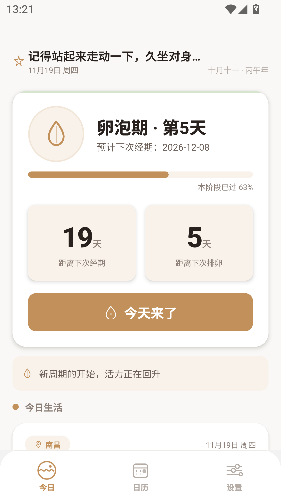
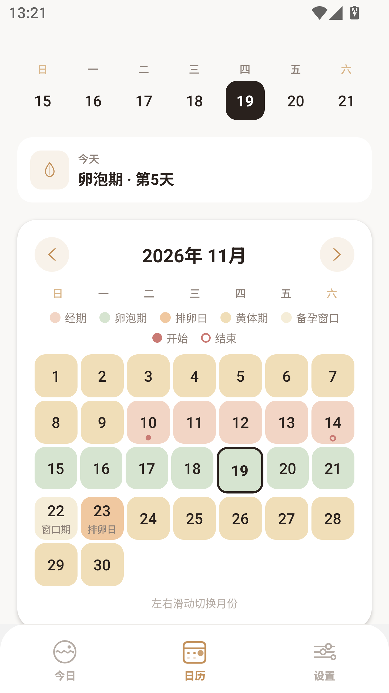
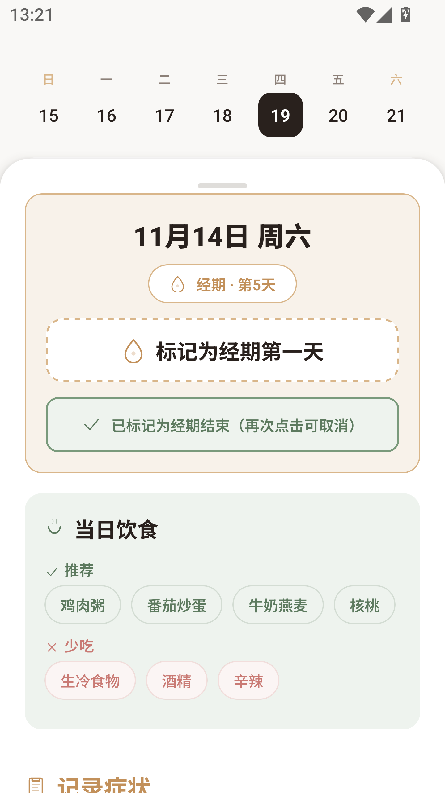
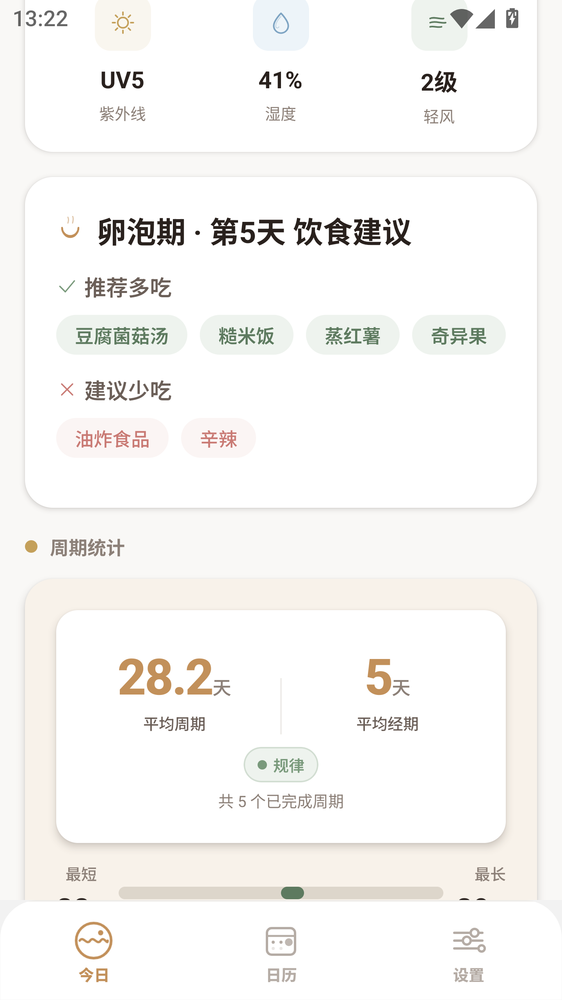
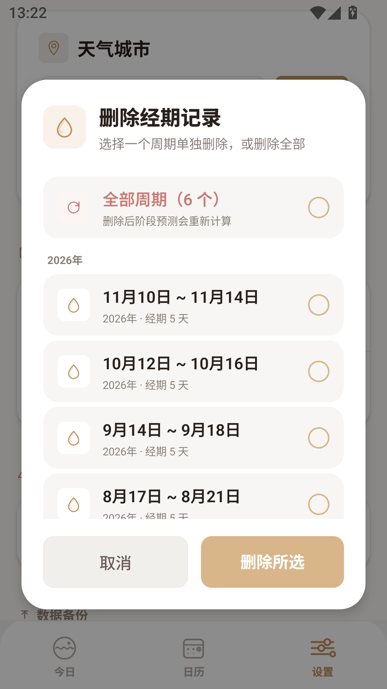

<div align="center">


# FayeTide

**顺着潮汐，认识自己的身体节律。**

本地优先的中文经期追踪 App —— 周期预测、症状记录、农历黄历、天气感知的生活建议，全部离线跑在你的手机里。

[](CHANGELOG.md)
[](https://github.com/usernameycx/period-tracker)
[](https://expo.dev)
[](https://reactnative.dev)
[](https://www.typescriptlang.org/)
[](LICENSE)
[](https://github.com/usernameycx/period-tracker/actions/workflows/ci.yml)
[](CONTRIBUTING.md)

</div>

---

## 为什么做这个

市面上的经期 App 大多在做两件事：要你的手机号，和把数据传到云端。而经期数据是能推断出很多私密信息的东西，它不该离开你的设备。

FayeTide 的取舍很简单：

- **数据只存在本机**：SQLite 单文件，没有账号、没有埋点、没有后端。导出就是一个 JSON 文件。
- **预测要讲得清**：不是黑盒「AI 预测」，而是可读、可测、有单元测试覆盖的生理周期模型（见[周期预测模型](#周期预测模型)）。
- **建议要贴着生活**：把阶段的生理特点和当天的天气、当天的农历放在一起，给一句真正用得上的话，而不是一句「多喝热水」。

## 界面预览

<div align="center">
<table>
<tr>
<td align="center"><br /><sub>首页 · 阶段卡片与倒计时</sub></td>
<td align="center"><br /><sub>日历 · 阶段着色 + 开始/结束标记</sub></td>
<td align="center"><br /><sub>日详情 · 标记结束可反悔</sub></td>
</tr>
</table>
</div>

## 3.0 更新了什么

| 变化 | 说明 |
|------|------|
| 🩸 **经期结束可视化** | 日历上用**实心点标开始、空心圈标结束**，月历与周条同步，图例里成对出现 |
| ↩️ **结束标记可反悔** | 点「标记经期在此结束」后按钮不消失，原地变成「已标记为经期结束（再次点击可取消）」，点错了直接点回来 |
| 🗑 **删除粒度变细** | 经期记录可按**某个周期**删（按年分组）、症状可按**某一天**删（按月分组），不再只有「一键全清」 |
| 🧭 **周期一次生成** | 标记第一天后，经期 → 卵泡期 → 排卵日 → 黄体期整段连续着色，跨月自动衔接 |

完整变更见 [CHANGELOG.md](CHANGELOG.md)。

## 功能特性

### 🩸 周期管理

- **经期记录**：单击标记开始日，可随时标记结束日，自动算出实际经期长度
- **结束标记可回退**：标记结束的当天按钮会停在原地变成「已标记」，再点一次即取消
- **四阶段预测**：经期 / 卵泡期 / 排卵日 / 黄体期，附备孕窗口着色
- **动态周期模型**：按你真实的记录长度自适应，而不是死板的 28 天
- **统计洞察**：平均周期、最短/最长区间、规律性判定、已完成周期数

### 📝 每日记录

- **四维症状**：出血量、小腹不适、心情、精力
- **五个常见困扰**：头痛 / 腹胀 / 腰痛 / 胸胀 / 眼干
- 全部选项可反选，整行清空后自动删除空记录，不留下垃圾数据

### 🌤 生活化关怀

- **天气感知建议**：按温度 6 级、天气码分档，结合当前阶段给建议
- **逐日饮食建议**：覆盖完整周期 31 天的饮食规则，推荐 / 少吃两类
- **黄历农历**：公历 + 农历 + 干支 + 宜忌，中文语境下更自然
- **每日一句**：按时段（早 / 午 / 晚）轮换的问候语

### 🔔 每日播报

- 原生 `AlarmManager` 精确闹钟（不依赖 JS 常驻），iOS 降级为 `expo-notifications` 每日触发器
- **通知内容在触发瞬间实时计算**：阶段 + 天气 + 饮食 + 倒计时 / 经期结束 / 经期推迟 / 排卵提醒
- 三行结构：天气与生活建议 / 饮食提示 / 周期事件

### 🔐 数据自主

- 本地 SQLite（WAL 模式），无云端
- 导出 / 导入 JSON（文件分享 + 文件选择器 + 粘贴三种导入方式）
- **精细删除**：经期按周期删、症状按天删，也可以一键全删
- **删除前二次确认**，确认文案带完整日期，跨年也不会认错

## 使用指南

### 1. 记录第一次经期

打开 **日历** 页 → 点某一天 → 在弹出面板里点「标记为经期第一天」。

一旦标记，这一天之后的一整个周期都会被推算出来：经期 5 天（按你的历史自适应）→ 卵泡期 → 排卵日 → 黄体期，跨月也能连续看到。

### 2. 标记经期结束（以及反悔）

经期第 2～9 天，点任意一天 → 点「标记经期在此结束」。

标记成功后按钮**不会消失**，而是变成绿色的「已标记为经期结束（再次点击可取消）」。点错日期或想改，再点一次即可取消，然后去正确的那天重新标记。

> 已结束的周期会被固定下来，不会随着后续记录的全局平均值漂移。

### 3. 记录当天的症状

同一天的面板里往下滑，就是「记录症状」：出血量 / 小腹不适 / 今日心情 / 精力状态 / 其他身体症状。

所有选项都能再点一次取消；当一整天的内容都被清空时，这条记录会自动删除，不会留下空行。

### 4. 查看预测、饮食与统计

<div align="center"></div>

- **首页**：今日阶段、距离下次经期 / 排卵的天数、「今天来了」快捷按钮
- **天气卡**：当前城市的温度、体感、紫外线、湿度、风力，以及结合阶段的建议
- **饮食卡**：按阶段与周期天数给出的推荐 / 少吃清单
- **周期统计**：平均周期、平均经期、规律性（需要至少 2 个周期）

### 5. 备份与删除

<div align="center"></div>

设置页 → **数据管理**：

- **删除经期记录**：选择某一个周期（按年分组，显示经期天数）或「全部周期」
- **删除症状记录**：选择某一天（按月分组，显示星期与记录项数）或「全部记录」
- 选中后还要再确认一次，确认文案会写明具体删的是哪一段

**数据备份**：导出 JSON 分享出去；导入支持选择文件、粘贴 JSON 两种方式。

## 周期预测模型

入口：`src/services/prediction.ts`，被 `src/hooks/useCurrentPhase.ts` 与日历着色共用，**同一套算法在原生通知里用 Kotlin 复刻**（`DailyNotificationReceiver.kt`），保证 JS 与通知显示一致。

以 28 天标准周期为例：

| 阶段 | 周期天数 | 默认长度 | 日历配色 |
|------|----------|----------|----------|
| 经期 | Day 1–5 | 5 天（动态） | 珊瑚粉 |
| 卵泡期 | Day 6–13 | 8 天（可变） | 嫩绿 |
| 排卵日 | Day 14 | 1 天 | 蜜桃橙 |
| 黄体期 | Day 15–28 | 14 天（固定） | 浅鹅黄 |
| 备孕窗口 | 排卵前 1 天 | 1 天 | 浅米（仅着色） |

几个刻意的设计：

- **排卵日锚定「下次经期前 14 天」**，而不是「周期第 14 天」——周期长度变化时这才符合生理学
- **黄体期固定 14 天**：这是整个周期里最稳定的阶段，变化的是卵泡期
- **卵泡期浮动**：实际经期结束时卵泡期会自动伸缩
- **`end_date` 优先**：有真实经期结束日就用真实的，没有才回退到均值 / 默认值
- **稀疏数据加权**：不足 3 条记录时向默认值混合，避免用一两条记录过拟合
- **`diffDays` 数日期差而非含首含尾**，所以排卵阈值用 `OVULATION_BEFORE_PERIOD + 1 = 15` 补偿

预测依据随数据量递进：

| 记录数 | 周期长度来源 | 经期长度来源 |
|--------|--------------|--------------|
| 1 条 | 默认 28 天 | 默认 5 天 |
| 2 条以上 | 真实起始日间隔均值 | 默认 / 估算 |
| 3 条以上且含 `end_date` | 真实间隔均值 | 真实经期长度均值 |

## 技术架构

| 层次 | 选型 |
|------|------|
| 框架 | Expo SDK 57（bare workflow，`android/` 已提交） |
| UI | React Native 0.86 + expo-router（文件路由） |
| 语言 | TypeScript 6.0（strict） |
| 数据库 | expo-sqlite（本地 SQLite，WAL） |
| 状态 | React Context × 4（周期 / 天气 / 设置 / 选中日期） |
| 图标 | 全部自绘 SVG（react-native-svg），无图标字体 |
| 定位 | 高德定位 SDK（原生模块 `AMapLocationModule`） |
| 天气 | 高德地理编码 + Open-Meteo 实时天气 |
| 农历 | lunar-typescript |
| 通知 | AlarmManager + BroadcastReceiver（Kotlin） |
| 构建 | EAS Build（APK / AAB） |

**三条主要数据流：**

```
记录   用户操作 → Context(乐观更新) → SQLite → 重新计算阶段 → 三端 UI 刷新
天气   启动定位 → 高德 SDK 取城市 → 高德地理编码取经纬度 → Open-Meteo 取实况
通知   AlarmManager 定时 → Receiver 读 SQLite → 实时抓天气 → 拼装通知 → 重排明日
```

天气链路细节、启动时序、数据库 schema、通知拼装逻辑见 [`docs/ARCHITECTURE.md`](docs/ARCHITECTURE.md)。

## 快速开始

### 环境要求

- Node.js ≥ 20
- Android Studio + Android SDK（编译原生模块时需要）
- JDK 17（Gradle 9 要求）
- 真机或模拟器（Android 8.0+）

### 安装

```bash
git clone https://github.com/usernameycx/period-tracker.git
cd period-tracker
npm install
```

### 配置高德 Key

天气和定位依赖高德，**仓库里不保存任何 key**，需要你申请自己的。见下一节。

### 启动

```bash
cp .env.example .env    # 填入 AMAP_WEB_KEY
npm run android         # 编译并安装到设备（首次约 5–10 分钟）
```

如果只想跑 Expo 开发服务器（不装原生模块，定位会自动降级为手动选城市）：

```bash
npm start
```

## 配置高德 Key

需要**两个** key，来自同一个高德账号，用途不同：

| 变量 | 平台类型 | 用途 | 配置位置 |
|------|----------|------|----------|
| `AMAP_WEB_KEY` | Web 服务 | 城市名 → 经纬度（地理编码） | `.env` 或 EAS 环境变量 |
| `AMAP_API_KEY` | Android 平台 | 原生地图定位 SDK | `android/local.properties` 或环境变量 |

**申请步骤：**

1. 打开 [高德开放平台控制台](https://console.amap.com/dev/key/app)，注册并完成个人开发者认证
2. 新建 Key → 服务平台选 **Web服务**，得到 `AMAP_WEB_KEY`（此 key 无需绑定签名）
3. 再新建一个 Key → 服务平台选 **Android平台**，绑定：
   - 包名：`com.periodtracker.app`
   - 发布版 SHA1：你的 release keystore 指纹
   - 调试版 SHA1：`debug.keystore` 的指纹（`keytool -list -v -keystore debug.keystore -storepass android`）
4. 写入本地配置：

```bash
# .env（已被 .gitignore 忽略）
AMAP_WEB_KEY=你的Web服务key

# android/local.properties（已被 .gitignore 忽略）
AMAP_API_KEY=你的Android平台key
```

> ⚠️ **不要**把 key 写进 `app.json`、`android/gradle.properties`、Kotlin/TS 源码——这些文件都会进仓库。
> 如果曾经提交过，请立刻去控制台删除旧 key 重建，历史提交里的 key 永远算泄露。

EAS 云端构建时，把这两个变量加到 expo.dev → 项目 → **Environment Variables** 即可。

## 构建与发布

```bash
# 本地打 APK（调试/自用）
cd android
./gradlew assembleRelease -PreactNativeArchitectures=arm64-v8a
# 产物：android/app/build/outputs/apk/release/app-release.apk

# 云端构建（推荐给正式包，含签名）
npx eas build --platform android --profile preview    # APK
npx eas build --platform android --profile production # AAB
```

因为 `android/` 是提交进仓库的（为了自定义原生启动屏），`app.json` 里不要新增 `splash` / `icon` / `orientation` 等会被忽略的键，原生资源直接改 `android/app/src/main/res/`。

> **Windows 本地构建注意**：新架构 codegen 的对象文件路径可能超过 260 字符。仓库已在 `android/app/build.gradle` 中**仅对 Windows** 固定 CMake 3.31.6（自带 ninja 1.12+ 支持长路径），Linux / EAS 构建不受影响。

## 测试

```bash
npm test           # Node 原生测试运行器（scripts/run-tests.mjs）
npm run typecheck  # 类型检查
```

现有覆盖：

| 测试 | 覆盖内容 |
|------|----------|
| `tests/prediction.test.ts` | 阶段划分、排卵锚点、动态周期长度、跨记录边界 |
| `tests/period-validation.test.ts` | 经期起止日校验、长度约束 |
| `tests/advice.test.ts` | 温度分层、天气码映射、阶段建议稳定性 |
| `tests/data-management.test.ts` | 删除列表的分组、年份标签、跨年同月同日区分 |

CI 在每次 push / PR 时自动跑类型检查和测试（见 `.github/workflows/ci.yml`）。

## 目录结构

```
app/                     # expo-router 页面
  _layout.tsx            # 根布局：Providers + 启动流程 + 原生启动屏
  (tabs)/
    index.tsx            # 首页：问候、周期卡片、天气、饮食、统计、名言
    calendar.tsx         # 日历：周条 + 月视图 + 日详情抽屉
    settings.tsx         # 设置：通知时间、城市、数据管理、备份
src/
  components/            # UI 组件（全部自绘 SVG 图标在 Icon.tsx）
  context/               # Period / Weather / Settings / SelectedDate
  hooks/                 # useCurrentPhase
  services/              # 预测、建议、农历、天气、通知、统计、删除列表
  db/                    # SQLite 初始化与各表 CRUD
  constants/             # 主题 token、阶段、症状、天气建议映射
  utils/                 # 日期工具、备份序列化
android/                 # 已提交的原生工程（自定义启动屏、定位/闹钟模块）
  app/src/main/java/com/periodtracker/app/
    AMapLocationModule.kt        # 高德定位 JS↔Native 桥
    DailyAlarmModule.kt          # 闹钟调度桥
    DailyNotificationReceiver.kt # 通知拼装（含 Kotlin 版阶段算法）
docs/                    # 架构、隐私、安全、设计文档与截图
tests/                   # 单元测试
scripts/                 # 图标生成、测试运行器
plugins/                 # Expo config plugin（启动屏窗口背景）
```

## 已知问题

- **天气源在境内偶尔超时**：`api.open-meteo.com` 在国内部分网络下会出现连接超时（同门其他接口正常）。表现为天气卡片显示「网络请求失败」，点重试通常可恢复。后续计划做主备接口回退。
- **模拟器测不了定位**：高德定位需要基站 / Wi-Fi / GPS 等定位源，模拟器提供不了（返回错误码 6，key 校验失败才是错误码 7）。请用真机验证定位。
- **iOS 未适配**：定位与精确闹钟依赖 Android 原生模块，iOS 上会自动降级（手动选城市 + `expo-notifications` 定时）。
- **签名**：仓库内 `debug.keystore` 仅用于本地/预览包，正式发布前需替换为自己的 keystore。

## 路线图

- [ ] 周期趋势图表（长度变化可视化）
- [ ] 天气接口主备回退 + 失败时的过期缓存兜底
- [ ] 删除列表支持搜索 / 按月份跳转
- [ ] iOS 适配
- [ ] 多语言（en / ja）
- [ ] 端到端加密的可选云同步

## 贡献

欢迎 Issue 和 PR。提交前请先读 [`CONTRIBUTING.md`](CONTRIBUTING.md)，尤其是「不要提交任何 key」这一条。

- 改周期算法时，记得同步 `DailyNotificationReceiver.kt` 里的 Kotlin 实现
- 新增 UI 时使用 `src/constants/theme.ts` 的 token，不要写裸色值

## 致谢

- [Expo](https://expo.dev) / [React Native](https://reactnative.dev) —— 跨端底座
- [Open-Meteo](https://open-meteo.com) —— 免费天气数据（CC BY 4.0）
- [高德开放平台](https://lbs.amap.com) —— 定位与地理编码
- [lunar-typescript](https://github.com/6tail/lunar-typescript) —— 农历与黄历
- 所有图标为项目自绘 SVG，未使用第三方图标库

## 免责声明

FayeTide 是**记录与预测工具，不是医疗器械**，不能用于避孕、诊断或治疗。预测结果基于历史记录的统计推断，存在个体差异。如有健康问题请咨询专业医生。

## 许可证

[MIT](LICENSE) © 2026 usernameycx
